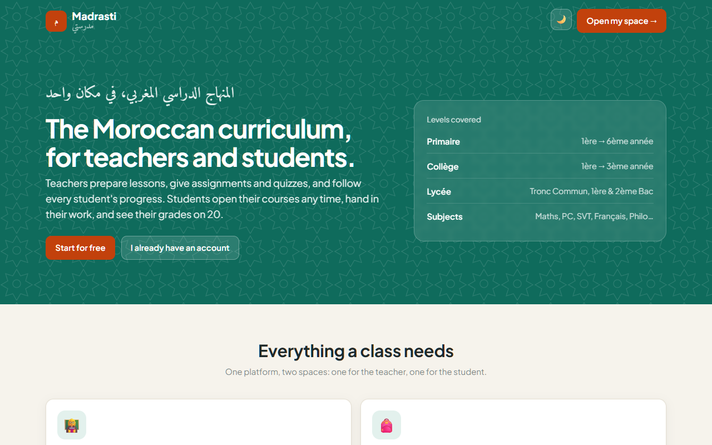
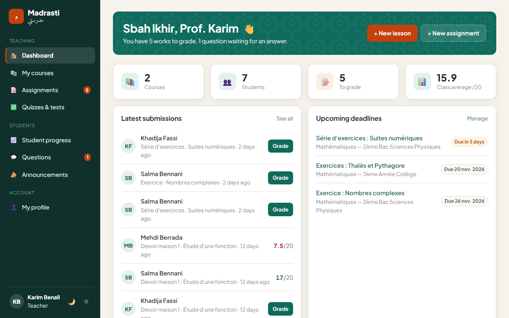
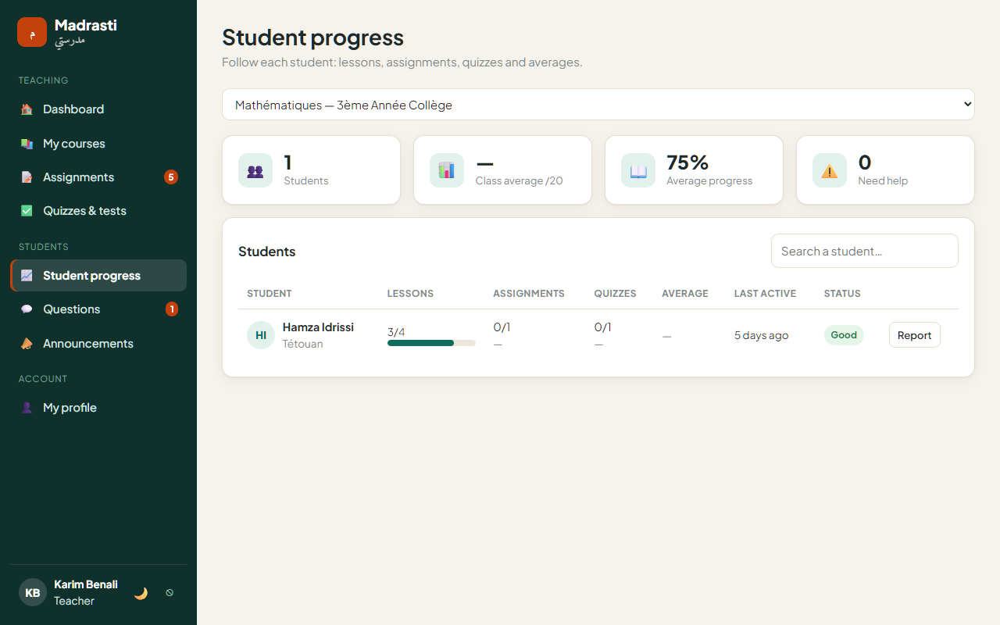
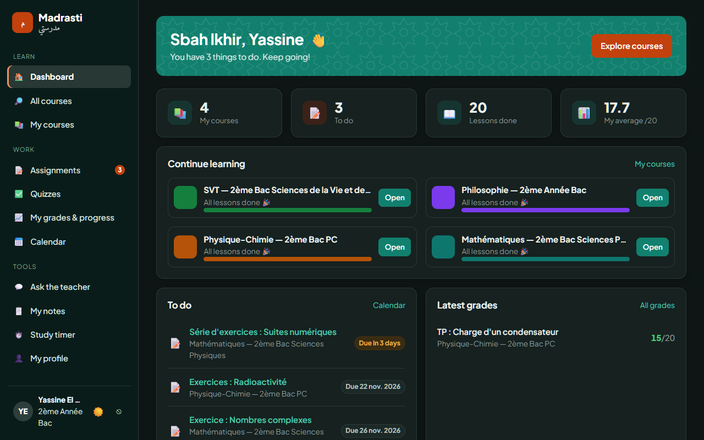
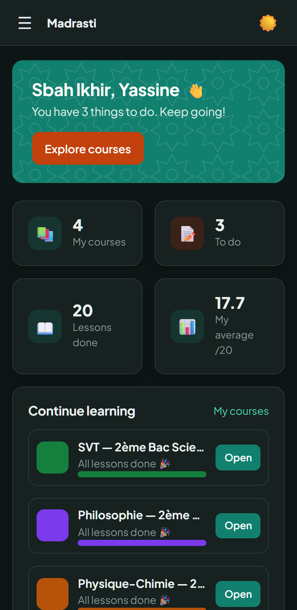

<div align="center">

# Madrasti · مدرستي

**A learning management platform for the Moroccan school curriculum, with one space for teachers and one for students.**




</div>

## About

Madrasti ("my school" in Arabic) covers the official Moroccan levels, from **1ère Année Primaire** to **2ème Année Bac**, with grades on 20.

- **Teachers** prepare lessons, give assignments and quizzes, grade work, and follow the progress of every student.
- **Students** open their courses at any time, hand in their work, take quizzes, and see their grades and averages.

The frontend is plain HTML, CSS and JavaScript (no framework, no build step). The backend is a REST API built with Express and MongoDB.

## Screenshots

| Teacher dashboard | Student progress tracking |
|---|---|
|  |  |

| Student dashboard (dark mode) | Mobile |
|---|---|
|  |  |

## Features

### Teacher space
- **Courses** organised by subject and official level
- **Lesson editor:** objectives, content, video link, attached files, draft or published
- **Assignments** with due dates: see who submitted, who is late and who is missing, then grade with feedback
- **Quizzes** (multiple choice), corrected automatically, with a success rate per question
- **Progress tracking** per course: lessons done, averages on 20, last activity, a "needs help" flag, and a printable report per student
- **Questions and announcements:** answer student questions and post news to a class

### Student space
- **Course catalogue** with filters by level and subject; join or leave a course
- **Lessons** available at any time, with "mark as done" and personal notes saved automatically
- **Assignment submission** (text and files, up to 5 files of 15 MB), with grade and feedback
- **Timed quizzes** with instant correction
- **Grades and progress:** average per subject and general average on 20
- **Study tools:** deadline calendar, "Ask the teacher", notes, Pomodoro timer

### Platform
- **Accounts and roles:** JWT sessions, passwords hashed with bcrypt, separate teacher and student access
- **Email verification:** 6-digit code (15 minutes, 5 tries, 60-second resend delay), typo detection (`gmial.com` → `gmail.com`), and a check that the email domain can receive mail
- **City and school picker:** 3,758 schools in 197 Moroccan cities, from OpenStreetMap
- **Message moderation:** disrespectful words in English, French, Darija and Arabic are replaced with `****`, checked on the server
- **Light and dark mode**, saved per user, following the system setting on first visit
- **Responsive** layout for phones, tablets and computers
- **Basic hardening:** rate limits on login and API routes, security headers, uploaded files other than images and PDFs are served as downloads

## Tech stack

| Layer | Technology |
|---|---|
| Frontend | HTML, CSS (custom properties), vanilla JavaScript, hash-router single-page apps |
| Backend | Node.js, Express 4 |
| Database | MongoDB with Mongoose 8 |
| Auth | JSON Web Tokens, bcryptjs |
| Files | Multer |
| Email | Nodemailer (Gmail SMTP) |

## Getting started

### Requirements

- [Node.js](https://nodejs.org) 20.12 or newer
- MongoDB, in one of these forms:
  - a MongoDB server already running on `mongodb://127.0.0.1:27017`, **or**
  - any MongoDB connection string in `MONGO_URI` (MongoDB Atlas for example), **or**
  - a portable `mongod` binary: set its path in `MONGOD_PATH` and the app starts it for you

### Install and run

```bash
git clone https://github.com/Y0USSEF000/madrasti.git
cd madrasti
npm install
cp .env.example .env
npm run seed
npm start
```

Then open <http://localhost:5050>.

`npm run seed` loads the demo data. **It deletes every existing account and course first**, so use it only on a development database.

On Windows you can also double-click `start.bat`.

### Demo accounts

All demo accounts use the password `password123`.

| Role | Email |
|---|---|
| Teacher | `teacher@madrasti.ma` |
| Student | `student@madrasti.ma` |

The seed creates 5 teachers and 8 students in total, with 7 courses, lessons, assignments, quizzes and grades.

## Configuration

Settings are read from a `.env` file at the project root (see [`.env.example`](.env.example)).

| Variable | Default | Purpose |
|---|---|---|
| `PORT` | `5050` | HTTP port |
| `MONGO_URI` | `mongodb://127.0.0.1:27017/madrasti` | MongoDB connection string |
| `MONGOD_PATH` | `~/tools/mongodb/bin/mongod` | Portable MongoDB binary, started only if no server answers |
| `JWT_SECRET` | created on first start | Secret key that signs login sessions |
| `SMTP_USER` | empty | Gmail address used to send verification codes |
| `SMTP_PASS` | empty | Gmail [app password](https://myaccount.google.com/apppasswords) |
| `CLOUDFLARED_PATH` | `~/tools/cloudflared/cloudflared` | Cloudflare tunnel binary, used by `npm run share` |

**Email test mode.** While `SMTP_USER` and `SMTP_PASS` are empty, no email is sent and the verification code is shown on the screen. This is for development only: fill both values before real users sign up.

## Share with a public link

```bash
npm run share
```

This starts the app and opens a free [Cloudflare quick tunnel](https://developers.cloudflare.com/cloudflare-one/connections/connect-networks/do-more-with-tunnels/trycloudflare/). It prints a public `https://….trycloudflare.com` address that works while the command is running. The address changes on every start. It needs the `cloudflared` binary (see `CLOUDFLARED_PATH`).

## Project structure

```
madrasti/
├── server.js            Express app, rate limits, static files
├── config.js            Settings and .env loading
├── db.js                MongoDB connection (starts a local mongod if needed)
├── seed.js              Demo data
├── share.js             Public link through a Cloudflare tunnel
├── models/              Mongoose models (User, Course, Lesson, Assignment, Quiz, …)
├── routes/              REST API (auth, courses, lessons, assignments, quizzes, misc)
├── middleware/          Auth, roles, uploads
├── utils/               Mailer, moderation, school loader
├── scripts/             School dataset builder, moderation tests
├── seed-data/           School list (OpenStreetMap)
└── public/              Frontend
    ├── index.html       Landing page
    ├── auth.html        Log in, sign up, email verification
    ├── teacher.html     Teacher app  (js/teacher.js)
    ├── student.html     Student app  (js/student.js)
    ├── css/style.css    Design system, light and dark themes
    └── js/common.js     Shared API client, router, UI helpers
```

## API overview

All routes are under `/api` and return JSON. Protected routes expect `Authorization: Bearer <token>`.

| Area | Routes |
|---|---|
| Auth | `POST /auth/register`, `/auth/verify`, `/auth/resend`, `/auth/login` · `GET/PUT /auth/me` |
| Places | `GET /cities`, `GET /schools?city=` |
| Courses | `GET /courses`, `/courses/mine` · create, edit, delete · enroll, leave |
| Lessons | view, create, edit, mark complete, personal note |
| Assignments | list, create, submit, grade |
| Quizzes | create, attempt (auto-graded), results |
| Progress | `GET /progress/me`, `/progress/course/:id`, `/dashboard` |
| Communication | announcements, questions, `POST /moderation/check` |

## Scripts

| Command | What it does |
|---|---|
| `npm start` | Start the server |
| `npm run seed` | Reset the database and load the demo data |
| `npm run share` | Start the server with a public link |
| `npm run test:moderation` | Run the moderation word-filter checks |
| `node scripts/build-schools.js` | Rebuild `seed-data/schools.json` from an OpenStreetMap export (query in `scripts/overpass.ql`) |

## Data and credits

The school list comes from [OpenStreetMap](https://www.openstreetmap.org/copyright), © OpenStreetMap contributors, under the Open Database License (ODbL). See [NOTICE.md](NOTICE.md).

## License

The code is released under the [MIT License](LICENSE).
